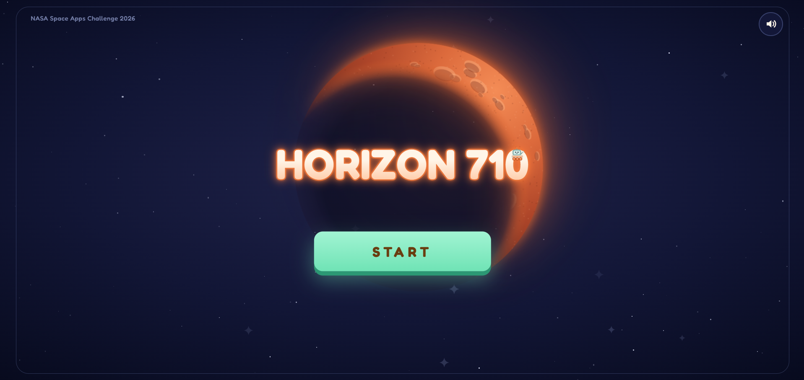
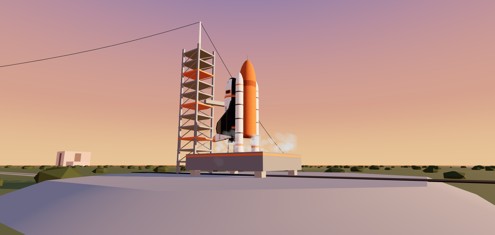
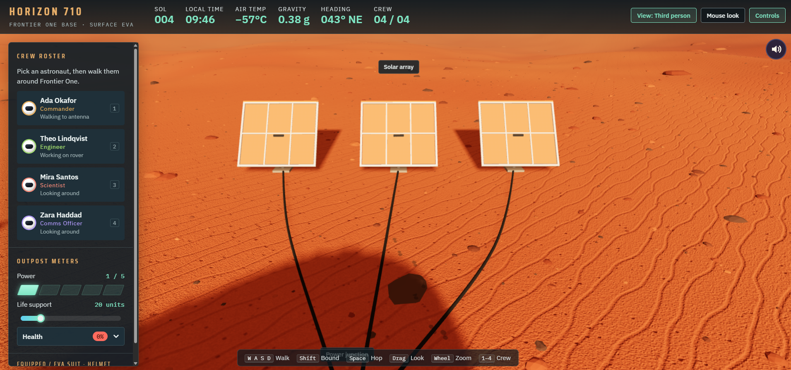
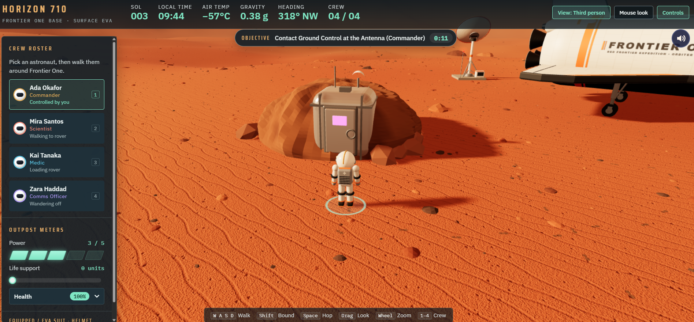
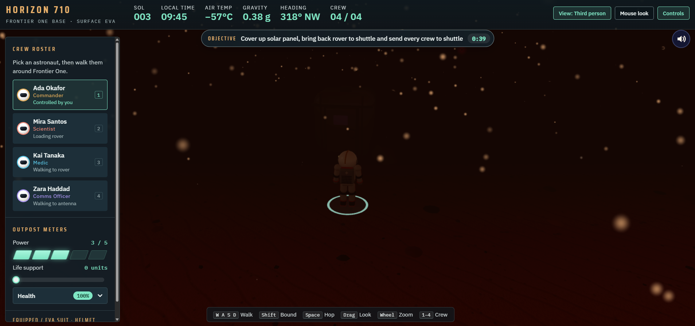
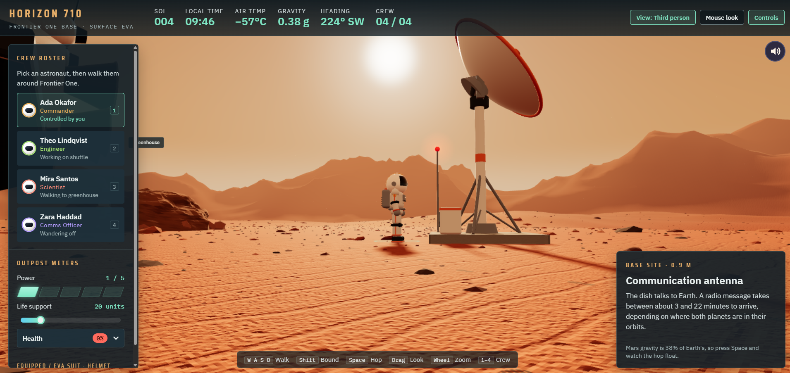
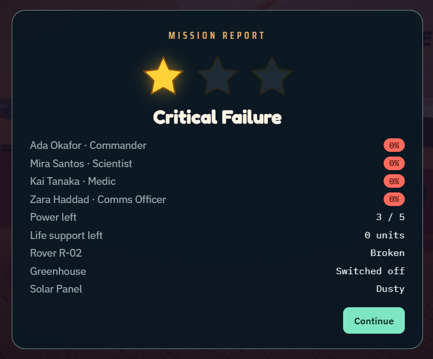

<div align="center">

# 🚀 HORIZON 710

### Junior Astronaut Mission Trainer

**Every space mission is a chain of trade-offs, and the consequences of a bad call can arrive days later.**

[](https://youtu.be/REPLACE_WITH_YOUR_VIDEO_ID)

**Made by Team Digonto · Daffodil Institute of Information Technology · Bangladesh**

[Play](https://usernaxaoa.github.io/HORIZON-710/) · [Video](https://youtu.be/REPLACE_WITH_YOUR_VIDEO_ID) · [How to play](#-how-to-play) · [The four Sols](#-the-four-sols) · [NASA data](#-nasa-data-behind-the-game) · [Use of AI](#-use-of-ai-transparency)

</div>

---



## 📖 Table of contents

1. [What is HORIZON 710?](#-what-is-horizon-710)
2. [Why this game?](#-why-this-game)
3. [Quick start](#-quick-start)
4. [How to play](#-how-to-play)
5. [Pre-launch: crew and cargo](#-pre-launch-crew-and-cargo)
6. [The four Sols](#-the-four-sols)
7. [The economy: power, life support, health](#-the-economy-power-life-support-health)
8. [Scoring and endings](#-scoring-and-endings)
9. [Screenshots](#-screenshots)
10. [NASA data behind the game](#-nasa-data-behind-the-game)
11. [Accessibility and sound](#-accessibility-and-sound)
12. [Technical overview](#-technical-overview)
13. [Run it, host it](#-run-it-host-it)
14. [Use of AI (transparency)](#-use-of-ai-transparency)
15. [Known limitations](#-known-limitations)
16. [Roadmap](#-roadmap)
17. [Team](#-team)
18. [References](#-references)
19. [License](#-license)

---

## 🌍 What is HORIZON 710?

**HORIZON 710** is a browser game for students aged **11 to 13**. It makes real engineering trade-offs tangible and fun. The player follows **one mission, from the launch pad to the surface of Mars**:

1. A friendly guide named **Pip** helps you choose a destination, a crew and your cargo.
2. A launch sequence takes your shuttle to orbit.
3. Your crew lands and lives **four Sols (Mars days)** in an explorable 3D base.
4. Each Sol brings a **NASA-inspired problem**: dust on the solar panels, food loss, a global dust storm, and a solar flare.
5. Every choice costs **power, life support or crew health**, and early choices (like your radiation shield) come back to matter later.
6. The game ends with a **1 to 3 star Mission Report**.

The whole game is **one HTML file** (`index.html`). There is nothing to install and no build step.

> **Status:** first prototype, built for the NASA Space Apps Challenge 2026 local event. We are building it part by part and will keep improving it.

---

## 🎯 Why this game?

Real missions are not won by one big decision. They are won (or lost) by many small ones: what to pack, who to bring, what to fix first, and what to leave for later. Students rarely see that. HORIZON 710 lets them **feel it**:

| Idea students meet | Where it appears in the game |
|---|---|
| Everything has a cost | Cargo limit, power cost of every action |
| Mass is limited | The 150-unit shuttle: a heavy shield means less life support |
| The right person for the job | Only certain roles can clean panels or build the greenhouse |
| Consequences arrive later | Your pre-launch shield decides Sol 4 damage; Sol 3 choices create Sol 4 penalties |
| Real missions face real problems | Each Sol is based on a real NASA mission or research |
| Time pressure forces priorities | Timed decisions; you cannot save everything in the dust storm |

**Learning goals:** systems thinking, resource management, cause and effect over time, and curiosity about real NASA missions (InSight, Opportunity, ISS Veggie).

---

## ⚡ Quick start
**Play locally:**

```bash
git clone https://github.com/mmhHemel/HORIZON-710.git
cd HORIZON-710
# then just open index.html in a modern browser
```

You need a modern browser with **WebGL** and an **internet connection** (Three.js and fonts load from CDNs).

---

## 🎮 How to play

### Controls

| Action | Desktop | Phone / tablet |
|---|---|---|
| Rotate camera | Drag with the mouse | Drag with one finger |
| Zoom | Scroll wheel | Use the **View** button (Third person / Close-up / Wide) |
| Switch astronaut | Click an astronaut, click the **Crew Roster**, or press **1, 2, 3, 4** | Tap an astronaut or the roster |
| Walk | **W A S D** or arrow keys | On-screen joystick |
| Jump | Space | Jump button |
| Interact | Click an object (solar panel, rover, antenna, terminal, greenhouse site) | Tap an object |
| Sound | Mute button | Mute button |

### A typical run

1. Press **START**.
2. Pip asks you to pick **Mars** (the Moon is shown as the next destination).
3. Pick **4 of 5 crew** members.
4. Pack your **cargo** within 150 units.
5. Watch the **launch**, then the shuttle approaches Mars and lands.
6. Play **Sol 1 to Sol 4**. Read the warnings, pick the right astronaut, and act before the timer runs out.
7. Read your **Mission Report**, then **Retry** or **Roam Freely**.

---

## 🧰 Pre-launch: crew and cargo

### Crew: choose 4 of 5

| Role | What they do | If left behind (as the crew screen explains) |
|---|---|---|
| **Commander** | Leads the team and can do other jobs, but slowly | Nobody leads; the others decide together, which is slower |
| **Engineer** | Fixes machines and keeps the power running | Repairs take longer and use more power |
| **Scientist** | Studies the planet and looks after plants | Food and samples are harder to look after |
| **Medic** | Keeps everyone healthy | Sick or hurt crew heal more slowly |
| **Communications Officer** | Talks to Earth and reads radar to spot space weather early | Nobody reads Earth's messages or radar well; the Commander must try, slowly |

The crew you pick is **exactly the crew that appears on Mars**.

> **Prototype note:** the crew screen describes extra supplies when someone is left behind, but that cost is not charged yet. Role limits do apply: the Greenhouse (Sol 2), the Antenna (Sol 3) and the Base Diagnostics terminal (Sol 4) need the **Commander**, so a mission without one cannot finish those tasks.

### Cargo: 150 units maximum

Three choices compete for the same space, shown on a live **Total Cargo Load** meter.

| Choice | Option | Cargo cost | Trait |
|---|---|---|---|
| **Radiation shield** | Hydrogen Polymer | 30 units | 100% radiation protection on Sol 4 |
| | Hydrogen BNNT | 10 units | 80% radiation protection on Sol 4 |
| **Power supply** | Nuclear Battery (RTG) | 30 units | Gives 3 units of power every day |
| | Lightweight Space Battery | 10 units | Drops to 2 units on Sol 4 because of the cold |
| **Life support** | Slider | 1 unit per 1 life support (max 100) | Air, water and food. You cannot get more after landing |

**The trade-off:** protection and steady power are heavy. Light choices leave room for more life support, but they cost you later.

---

## 🪐 The four Sols

Each Sol starts with a morning message and a **−20 life support** overnight cost. Warnings come with a **More Info** button that shows a short, kid-friendly NASA story.

### Sol 1: Dust on the solar panels
*Inspired by NASA's InSight lander and the end of the Opportunity rover.*

- Pip's tips explain the controls, then you explore for a short while.
- A warning appears: fine Martian dust is blocking the solar panel array. A yellow bouncing arrow marks it.
- You have **30 seconds**. Only the **Engineer or Commander** may clean it.
- **Success:** −1 power and −10 life support today, but extra renewable power for Sols 2 to 4.
- **Wrong astronaut:** "Access Denied". No resources lost; the timer keeps running.
- **Timeout:** the crew rests, nothing is spent, but total power is **capped at 3** for the rest of the mission.

### Sol 2: Food and the greenhouse
*Inspired by the ISS "Veggie" plant experiment and Martian perchlorate soil.*

- Warning: packaged food is degrading. Fresh food needs a greenhouse, and Martian soil is toxic, so it must be indoors.
- You have **90 seconds**. Only the **Commander** can build the greenhouse (the Engineer is denied).
- **Success:** −1 power and −20 life support now. The greenhouse then uses **2 power per day** but makes **+20 life support** on later Sols and protects health.
- **Timeout:** every astronaut loses **10 health**, and the same penalty repeats on Sols 3 and 4.

### Sol 3: Global dust storm
*Inspired by the 2018 global dust storm that ended the Opportunity rover.*

1. Wind rises. The Commander must go to the **Communication Antenna** (45 seconds). The first try fails, the second works (−1 power). Others are denied.
2. A critical alert: cover the **solar panel**, bring the **rover** back to the shuttle, and send the **crew** inside through **Base Diagnostics**.
3. A second 45-second timer runs. **You cannot always do all three.**
4. The storm arrives with dense fog, darkness, camera shake and flying dust.

| What you did | What it costs on Sol 4 |
|---|---|
| Panel left uncovered | Clean it (1 power, 10 life support) or lose renewable power |
| Rover left outside | Repair it (1 power, 10 life support) or the rating drops |
| Crew left outside | −30 health. If the panel and rover are both done and the crew gets inside within 10 seconds, only −10. If the crew gets inside first, no loss |

### Sol 4: Solar flare
*Inspired by NASA DONKI space-weather alerts.*

- The **Medic** can heal the crew (10 life support for +10 health) if health is low.
- A **DONKI-style alert** hits after a short free roam: a Class-M flare with a proton spike.
- You have **30 seconds**. Only the **Commander** can use the Base Diagnostics terminal (others: −1 power).
- The Commander activates **Shelter Support** (−1 power), then sends everyone to the shuttle.
- **Your pre-launch shield decides the damage:**
  - Hydrogen Polymer: no health loss
  - Hydrogen BNNT: −10 health for every astronaut
- The camera looks at the sun and the screen fades to white.
- **Timeout:** the mission ends in critical failure.

---

## ⚙️ The economy: power, life support, health

| Resource | Starts | Changes |
|---|---|---|
| **Power** | Solar units + your power supply (max 5) | Actions cost 1 power; cleaning the panel secures extra renewable power; skipping it caps power at 3; the greenhouse uses 2 per day |
| **Life support** | What you packed (max 100) | −20 every night; heavy work costs 10 to 20; the greenhouse gives +20 per day |
| **Crew health** | 100% each | Food loss, dust exposure and radiation reduce it; the Medic can restore some |

Poor decisions either **hurt right away** or become **delayed faults** that arrive on a later Sol, as in real missions.

---

## ⭐ Scoring and endings

After the white-out, a **Mission Report** shows power left, life support left, rover state, greenhouse state, solar panel state and crew condition, with **1 to 3 stars**:

| Stars | Meaning |
|---|---|
| ⭐ | **Critical failure:** a crew member reached 0 health |
| ⭐⭐ | **Partial success:** everyone survived, but the rover was left broken, or power or life support ran out |
| ⭐⭐⭐ | **Perfect mission:** everyone survived, resources are above zero and the rover is safe |

Then choose:
- **Retry the Game:** reset everything and start again.
- **Roam Freely:** explore the Martian base with no timers or penalties.

---

## 🖼️ Screenshots

| Launch |
|:------:|
|  |

| Sol 1: dust on the solar panels | Sol 2: build the greenhouse |
|:---:|:---:|
|  |  |

| Sol 3: global dust storm | Sol 4: solar flare |
|:---:|:---:|
|  |  |

| Mission Report |
|:---:|
|  |

---

## 🛰️ NASA data behind the game

HORIZON 710 uses NASA documents and fact sheets as **educational sources**. It does not call live NASA APIs. The "DONKI ALERT" in Sol 4 is inspired by NASA's space-weather database and is not live data.

| Sol | Real-world source | What we took from it | Where it shows up |
|---|---|---|---|
| 1 | [NASA InSight power levels](https://www.nasa.gov/missions/insight/nasas-insight-still-hunting-marsquakes-as-power-levels-diminish/) | Dust cut InSight's power from about 5,000 Wh to about 500 Wh | Dust warning and More Info |
| 1, 3 | [Opportunity mission end](https://science.nasa.gov/missions/mer/nasas-opportunity-rover-mission-on-mars-comes-to-end/) | The 2018 global dust storm ended a 15-year mission | Dust storm story |
| 2 | [ISS Veggie fact sheet](https://www.nasa.gov/wp-content/uploads/2023/03/veggie-fact-sheet-508.pdf) | A plant chamber uses about 70 W for LED lights and fans | Greenhouse power cost |
| 2 | [Veggie expansion](https://www.nasa.gov/missions/station/veggie-will-expand-fresh-food-production-on-space-station/) | LED chamber for growing lettuce | Greenhouse lighting and visuals |
| 2 | [Astronaut space farming](https://www.nasa.gov/missions/station/nasa-astronaut-paints-a-picture-of-success-growing-plants-in-space/) | Fresh food supports morale and nutrition | "Fresh food protects health" |
| 3 | [NTRS dust study](https://ntrs.nasa.gov/api/citations/20190002304/downloads/20190002304.pdf) | Dust clogs mechanisms and damages seals | Rover-jam penalty |
| 3 | [Dust Mitigation Roadmap](https://ntrs.nasa.gov/api/citations/20260001844/downloads/Dust%20Mitigation%20Roadmap%20Rev%20C.pdf) | Dust is sticky, static and abrasive | "Return the rover to the shuttle" |
| 3 | [NASA OCHMO standards](https://www.nasa.gov/ochmo/human-spaceflight-and-aviation-standards/) | Martian dust exposure limits and toxic perchlorates | Crew-health dust penalty |
| 4 | [NIAC radiation shielding](https://www.nasa.gov/wp-content/uploads/2017/07/niac_2011_phasei_thibeault_radiationshieldingmaterials_tagged.pdf) | Hydrogen-rich BNNT shielding | Hydrogen BNNT option (80%) |
| 4 | [NASA DONKI](https://kauai.ccmc.gsfc.nasa.gov/DONKI/) | Solar flares and space-weather alerts | "DONKI ALERT" (inspiration only) |

**Other sources:** [Martian regolith](https://en.wikipedia.org/wiki/Martian_regolith) (perchlorate in soil), [AIAA 2010-6072](https://spacearchitect.org/pubs/AIAA-2010-6072.pdf) (regolith-covered inflatable habitat), and [hydrogen-rich polymer blends](https://www.researchgate.net/publication/408684533_Sustainable_Hydrogen-Rich_Polymer_Blends_for_Advanced_Space_Radiation_Shielding) (Hydrogen Polymer option).

> Numbers in the game are **simplified for learning**. They show the idea behind real trade-offs and are not mission-accurate simulations.

---

## ♿ Accessibility and sound

- **Sound effects** (rocket, wind, alerts) are generated in the browser with the Web Audio API, so there are no audio files. A **mute button** is always available and remembers your choice.
- **All guidance is shown as text**: Pip's tips, launch cues, warnings and results appear on screen, so the game works without sound.
- **Input options:** mouse, keyboard and touch (with an on-screen joystick).
- **Reduced motion:** the game respects the system "reduce motion" setting.
- **Labels:** buttons and star ratings have screen-reader labels.
- Timed decisions are short by design. Accessibility improvements such as adjustable timers are on the roadmap.

---

## 🏗️ Technical overview

| Item | Detail |
|---|---|
| **Format** | One file: `index.html` (about 366 KB, about 5,100 lines) |
| **3D engine** | [Three.js r128](https://threejs.org) from cdnjs |
| **Fonts** | Google Fonts: Saira Condensed, IBM Plex Sans, IBM Plex Mono, Fredoka |
| **Language** | Plain JavaScript, HTML, CSS. No framework, no build step |
| **State** | A shared plain JavaScript object (`gameState`) for planet, crew, resources and outpost economy |
| **Audio** | Synthesized with the Web Audio API |
| **Storage** | `localStorage` only for the mute setting |
| **Rendering** | WebGL, ACES filmic tone mapping, custom sky and terrain, dust and flare effects |

### How the file is organised

| Layer | What it does |
|---|---|
| **Menu layer** | Planet choice, crew choice, cargo screen, Pip the guide, loading and white fades |
| **Launch sequence** | Launch Control cues, countdown, liftoff, booster separation, orbit, approach to Mars |
| **3D game** | Terrain, base, shuttle, rover, solar array, antenna, terminal, greenhouse, crew, camera and input |
| **Sol gameplay** | Timers, role checks, decision trees and the outpost economy for Sols 1 to 4 |
| **Effects** | Dust storm (fog, light, camera shake, particles), solar flare (glitch, bloom, white-out) |
| **Mission Report** | Star rating, summary, retry and roam-freely modes |

Settings such as timers, costs and penalties live in **configuration objects** near the top of each section (for example `SOL_CONFIG`, `CREW_CONFIG`, `RESOURCE_CONFIG`), so the game rules can be tuned or swapped without rewriting the logic.

---

## 🛠️ Run it, host it

### Run locally

Open `index.html` in a browser. If your browser blocks anything when opened as a file, use a tiny local server:

```bash
python3 -m http.server 8000
# then visit http://localhost:8000
```

### Host on GitHub Pages

1. Put `index.html` at the **root** of the repository.
2. Go to **Settings → Pages**.
3. Under **Build and deployment**, choose **Deploy from a branch**, branch **main**, folder **/ (root)**, then **Save**.
4. After about a minute, the game is live at `https://usernaxaoa.github.io/HORIZON-710/`.

### Repository layout

```
HORIZON-710/
├── index.html        ← the whole game
├── README.md         ← this file
├── LICENSE           ← MIT
└── screenshots/      ← images used in this README
```

---

## 🤖 Use of AI (transparency)

We believe in being open about how this project was made.

| Tool | What we used it for |
|---|---|
| **Gemini** (Google) | Prompt engineering: writing, refining and fine-tuning the prompts for game rules, Sol events, trade-offs and system design |
| **Claude Code** (Anthropic) | Development assistance: generating and debugging the game code, and summarising public NASA pages into kid-friendly "More Info" texts |
| **ElevenLabs** | AI voice for the narration of our 240-second demo video only. **No AI voice is used inside the game** |

The game's sound effects are generated by code in the browser.

**What is ours:** the game idea, the trade-off design, the scoring rules, the choice of NASA sources, and every final decision. We reviewed the generated code and checked NASA facts against the linked sources.

---

## ⚠️ Known limitations

This is a first prototype. Please be aware of the following:

- **Left-behind crew costs are described but not charged yet** (role limits are enforced).
- **Mars only.** The Moon button is shown but is not playable yet.
- **The launch is a guided sequence,** not a playable GO/NO-GO decision stage (planned).
- **Needs internet** for Three.js and fonts.
- **Needs WebGL** and a reasonably modern device. Older phones may run slowly.
- **English only** for now.
- **Simplified science.** Values are tuned for learning, not for accuracy.
- Not yet tested on every browser and device.

If you find a bug, please open an **Issue** and tell us your browser, device and what happened.

---

## 🗺️ Roadmap

- [ ] Playable **GO / NO-GO Launch Director** stage with real launch lessons (such as the Challenger seal problem)
- [ ] **Moon route** with cold lunar nights and different trade-offs
- [ ] **Bangla** language support
- [ ] **Teacher reports:** a summary of the choices students made and why they matter
- [ ] Optional **live NASA DONKI data** for real space-weather events
- [ ] Adjustable timers and more accessibility options
- [ ] More Sols, more events and more specialist roles
- [ ] Merge with NASA's official 2026 challenge data when it is released

---

## 👥 Team

**Team Digonto** · Daffodil Institute of Information Technology · Cumilla, Bangladesh

| Name | Role |
|---|---|
| **Mohammad Mehadi Hasan** | Team lead |
| **Amena Begum** | Developer |
| **MD. Nafiz Mahmud Shawon** | Researcher |

Built for the **NASA Space Apps Challenge 2026**, Cumilla Local Event.
Team page: https://www.spaceappschallenge.org/2026/find-a-team/team-digonto/

---

## 📚 References

1. NASA, InSight power levels: https://www.nasa.gov/missions/insight/nasas-insight-still-hunting-marsquakes-as-power-levels-diminish/
2. NASA, Opportunity mission end: https://science.nasa.gov/missions/mer/nasas-opportunity-rover-mission-on-mars-comes-to-end/
3. NASA, Veggie fact sheet: https://www.nasa.gov/wp-content/uploads/2023/03/veggie-fact-sheet-508.pdf
4. NASA, Veggie expansion: https://www.nasa.gov/missions/station/veggie-will-expand-fresh-food-production-on-space-station/
5. NASA, astronaut space farming: https://www.nasa.gov/missions/station/nasa-astronaut-paints-a-picture-of-success-growing-plants-in-space/
6. NASA NTRS, dust study: https://ntrs.nasa.gov/api/citations/20190002304/downloads/20190002304.pdf
7. NASA, Dust Mitigation Roadmap: https://ntrs.nasa.gov/api/citations/20260001844/downloads/Dust%20Mitigation%20Roadmap%20Rev%20C.pdf
8. NASA OCHMO, human spaceflight standards: https://www.nasa.gov/ochmo/human-spaceflight-and-aviation-standards/
9. NASA NIAC, radiation shielding materials: https://www.nasa.gov/wp-content/uploads/2017/07/niac_2011_phasei_thibeault_radiationshieldingmaterials_tagged.pdf
10. NASA DONKI: https://kauai.ccmc.gsfc.nasa.gov/DONKI/
11. Martian regolith (Wikipedia): https://en.wikipedia.org/wiki/Martian_regolith
12. Greening the Red Planet: https://www.researchgate.net/publication/372317304_Greening_the_Red_Planet_Strategies_for_Cultivating_Plants_on_Mars
13. Regolith-shielded inflatable habitat, AIAA 2010-6072: https://spacearchitect.org/pubs/AIAA-2010-6072.pdf
14. Inflatable habitat in regolith simulant: https://www.researchgate.net/publication/415654968_Prototype_testing_of_an_inflatable_lunar_habitat_in_highlands_regolith_simulant
15. Hydrogen-rich polymer blends for radiation shielding: https://www.researchgate.net/publication/408684533_Sustainable_Hydrogen-Rich_Polymer_Blends_for_Advanced_Space_Radiation_Shielding
16. Three.js: https://threejs.org
17. Google Fonts: https://fonts.google.com

---

## 📄 License

Released under the **MIT License**. See the [LICENSE](LICENSE) file.
NASA names and mission facts belong to their respective owners and are used here for education.

---

<div align="center">

**Thank you for playing HORIZON 710.**
*Every choice matters. Good luck, crew.* 🚀

</div>
